# Flujo de neuronavegación: NEUROHUB → Unity → gafas AR

Este diagrama describe el flujo recomendado para transformar un estudio
DICOM/NIfTI en una escena de neuronavegación en Unity y desplegarla en unas
gafas de realidad aumentada.

> **Importante:** el resultado es una herramienta de visualización y
> planificación. La segmentación, el registro espacial y la alineación con el
> paciente deben ser validados por personal clínico antes de cualquier uso
> asistencial o intraoperatorio.

## Diagrama principal

```mermaid
flowchart LR
    classDef input fill:#19324a,stroke:#41d7e8,color:#eaf8ff,stroke-width:2px
    classDef process fill:#1d2938,stroke:#6ca8dc,color:#f4f8fc,stroke-width:1.5px
    classDef ai fill:#302448,stroke:#b78cff,color:#fff7ff,stroke-width:2px
    classDef quality fill:#3b3020,stroke:#ffbe5c,color:#fff8e8,stroke-width:2px
    classDef output fill:#173d35,stroke:#48e39a,color:#effff8,stroke-width:2px
    classDef unity fill:#263c31,stroke:#8ee6a9,color:#f2fff5,stroke-width:2px
    classDef ar fill:#3d2341,stroke:#ff83d1,color:#fff4fc,stroke-width:2px
    classDef warning fill:#431f27,stroke:#ff7d8c,color:#fff4f5,stroke-width:2px

    subgraph DATOS["01 · Datos médicos"]
        DICOM["Estudio DICOM<br/>Imagenes pacientes"]:::input
        METADATA["Metadatos DICOM<br/>modalidad · spacing · orientación"]:::process
        NIFTI["Volumen NIfTI<br/>rejilla espacial conservada"]:::input
        DICOM --> METADATA --> NIFTI
    end

    subgraph NEURO["02 · NEUROHUB"]
        LOAD["Carga del caso<br/>launcher.py ui"]:::process
        VIEW2D["Revisión 2D<br/>axial · coronal · sagital"]:::process
        DRAW["Delineado asistido<br/>pincel · borrar · deshacer"]:::process
        ANATOMY["Segmentación anatómica<br/>cerebro · cráneo"]:::ai
        TUMOR["Segmentación tumoral<br/>BraTS / máscara validada"]:::ai
        VASCULAR["Vasos / aneurisma<br/>solo si existe secuencia vascular adecuada"]:::ai
        MASK_QA{"¿Máscaras válidas,<br/>alineadas y no vacías?"}:::quality
        MESH["Reconstrucción 3D<br/>marching cubes · suavizado · mallas"]:::process
        GPU["AMD Radeon<br/>DirectML para ONNX validado<br/>VTK/OpenGL para visualización"]:::process
        LOAD --> VIEW2D --> DRAW
        LOAD --> ANATOMY
        LOAD --> TUMOR
        LOAD --> VASCULAR
        DRAW --> MASK_QA
        ANATOMY --> MASK_QA
        TUMOR --> MASK_QA
        VASCULAR -. opcional .-> MASK_QA
        GPU -. acelera inferencia/render .-> ANATOMY
        GPU -. acelera inferencia/render .-> TUMOR
        MASK_QA -- No --> VIEW2D
        MASK_QA -- Sí --> MESH
    end

    subgraph EXPORT["03 · Paquete de navegación"]
        STL["Mallas por estructura<br/>.stl"]:::output
        FBX["Modelo combinado<br/>.fbx para Unity"]:::output
        NIFTI_MASK["Máscaras y volumen<br/>.nii.gz para referencia"]:::output
        MANIFEST["Manifest del caso<br/>ID · spacing · orientación · origen"]:::quality
        MESH --> STL
        MESH --> FBX
        MASK_QA --> NIFTI_MASK
        METADATA --> MANIFEST
        MESH --> MANIFEST
    end

    subgraph UNITY["04 · Unity / escena de neuronavegación"]
        IMPORT["Importar FBX y materiales<br/>escala métrica coherente"]:::unity
        SCENE["Escena Unity<br/>cerebro · cráneo · tumor · vasos"]:::unity
        CONTROLS["Controles de revisión<br/>capas · transparencia · corte · etiquetas"]:::unity
        REGISTRATION["Registro espacial<br/>modelo ↔ paciente / referencia"]:::quality
        PERF{"¿Rendimiento y<br/>geometría aceptables?"}:::quality
        BUILD["Build para el dispositivo AR<br/>OpenXR / plataforma objetivo"]:::unity
        FBX --> IMPORT --> SCENE --> CONTROLS --> REGISTRATION --> PERF
        STL -. alternativa por capas .-> IMPORT
        NIFTI_MASK -. referencia clínica .-> SCENE
        MANIFEST --> REGISTRATION
        PERF -- No: optimizar --> OPT["LOD · decimación · compresión<br/>occlusion culling · shaders"]:::process
        OPT --> SCENE
        PERF -- Sí --> BUILD
    end

    subgraph GAFAS["05 · Gafas AR"]
        DEVICE["Gafas de realidad aumentada<br/>OpenXR runtime"]:::ar
        CALIB["Calibración del visor<br/>escala · anclaje · tracking"]:::quality
        OVERLAY["Overlay espacial<br/>modelo 3D alineado con el entorno"]:::ar
        REVIEW["Modo revisión segura<br/>capas · ocultar cráneo · resaltar tumor"]:::ar
        DEVICE --> CALIB --> OVERLAY --> REVIEW
    end

    NIFTI --> LOAD
    STL --> IMPORT
    FBX --> IMPORT
    BUILD --> DEVICE
    REGISTRATION -. requiere .-> CALIB

    SAFETY["No continuar si falla:<br/>orientación · escala · registro · validación clínica"]:::warning
    MASK_QA -.-> SAFETY
    REGISTRATION -.-> SAFETY
    CALIB -.-> SAFETY
```



## Lectura rápida del flujo

1. **Entrada:** se conserva el volumen original y sus metadatos espaciales.
2. **NEUROHUB:** se revisan cortes 2D, se dibuja o valida la lesión y se
   generan las máscaras anatómicas.
3. **Superficie:** las máscaras se convierten en mallas 3D con la misma escala
   espacial del estudio.
4. **Exportación:** el FBX combinado es el paquete principal para Unity; los
   STL permiten mantener estructuras como capas independientes.
5. **Unity:** se importan materiales, capas, controles, etiquetas y lógica de
   neuronavegación. La escena debe conservar unidades métricas.
6. **Registro:** antes de mostrar el modelo sobre el paciente se debe resolver
   el registro espacial, la calibración y el tracking del dispositivo.
7. **Gafas AR:** se genera el build para la plataforma objetivo y se prueba el
   anclaje en un entorno controlado.

## Paquete recomendado para Unity

```text
caso_890923/
├── neurohub_completo.fbx       # escena base combinada
├── mallas/
│   ├── cerebro.stl             # capa independiente opcional
│   ├── craneo.stl
│   ├── tumor.stl
│   ├── arterias.stl            # solo si la máscara existe y fue validada
│   └── venas.stl               # solo si la máscara existe y fue validada
├── segmentaciones/
│   ├── brain.nii.gz
│   ├── skull.nii.gz
│   └── tumor.nii.gz
└── manifest.json                # spacing, orientación, unidades y procedencia
```

## Estados visuales sugeridos en Unity

| Capa | Color sugerido | Uso |
|---|---:|---|
| Cráneo | Marfil translúcido | Referencia anatómica y límites |
| Cerebro | Rosa/beige suave | Contexto anatómico |
| Tumor | Magenta/rojo | Estructura prioritaria |
| Arterias | Rojo | Solo con secuencia vascular válida |
| Venas | Azul | Solo con secuencia vascular válida |
| Aneurisma | Naranja | Solo si existe una segmentación validada |

## Puntos de control obligatorios

- **Antes de segmentar:** confirmar modalidad, orientación y calidad del
  estudio.
- **Antes de crear mallas:** verificar que las máscaras comparten la misma
  rejilla y que no están vacías.
- **Antes de Unity:** comprobar que la escala del FBX corresponde al spacing
  del estudio y que el eje/origen están documentados.
- **Antes de las gafas:** probar el build sin paciente, calibrar tracking y
  verificar que el overlay no deriva.
- **Antes de cualquier uso clínico:** revisión y aprobación por personal
  especializado; no interpretar el overlay como diagnóstico automático.

## Implementación relacionada

- Punto de entrada: [launcher.py](../NEUROHUB/launcher.py)
- Segmentación y exportación: [segmentacion_completa.py](../NEUROHUB/src/segmentacion_completa.py)
- Procesamiento DICOM: [01_procesamiento_dicom.py](../NEUROHUB/src/01_procesamiento_dicom.py)
- Render de resultados: [render_caso.py](../NEUROHUB/render_caso.py)
